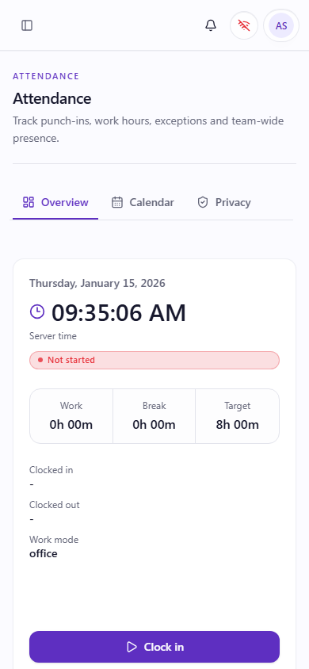
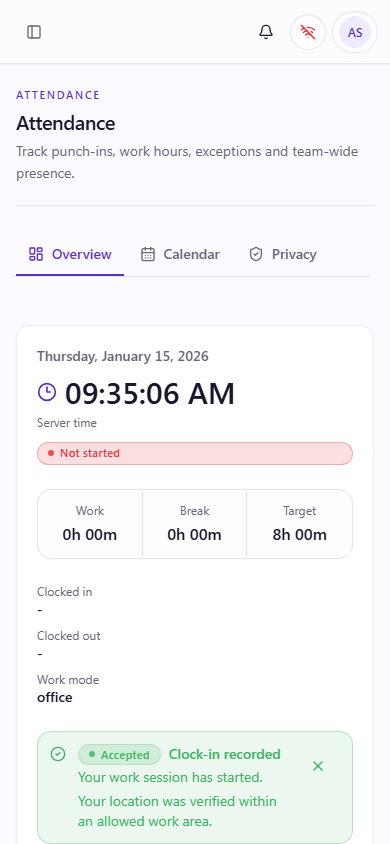
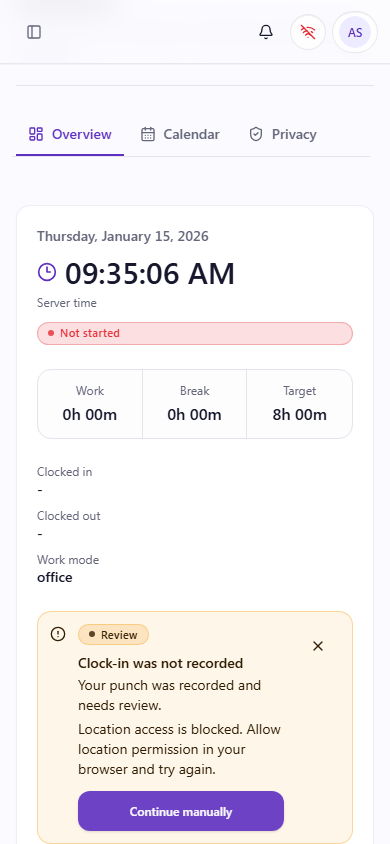
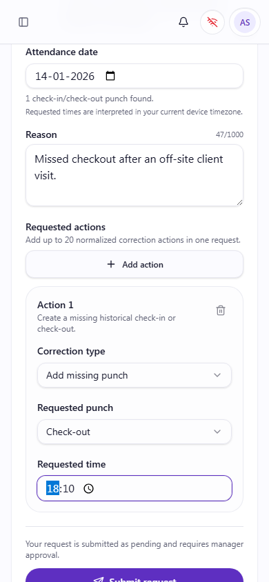
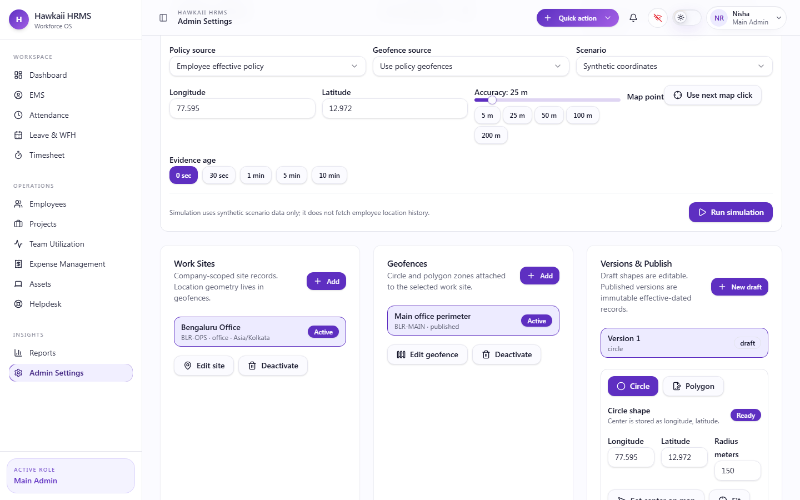
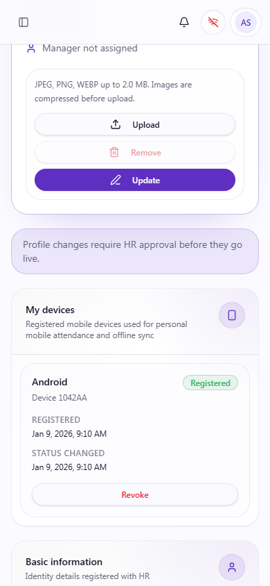
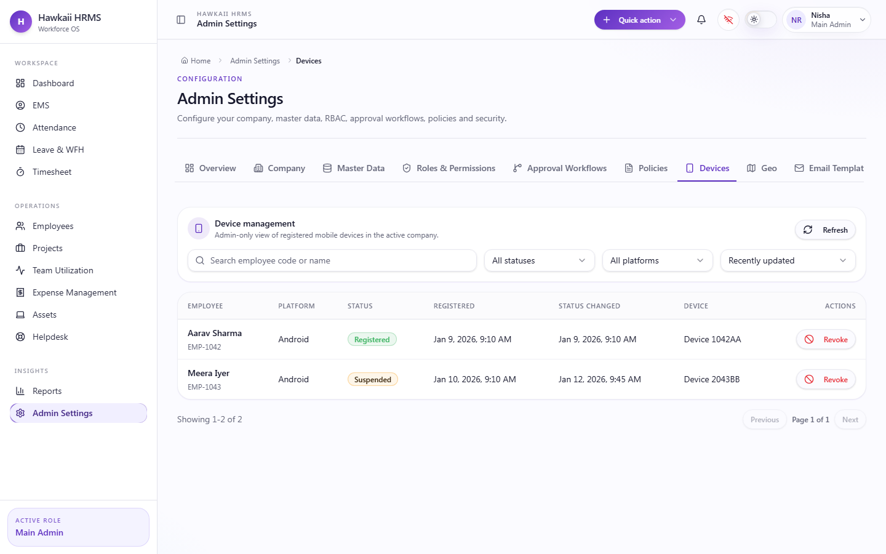
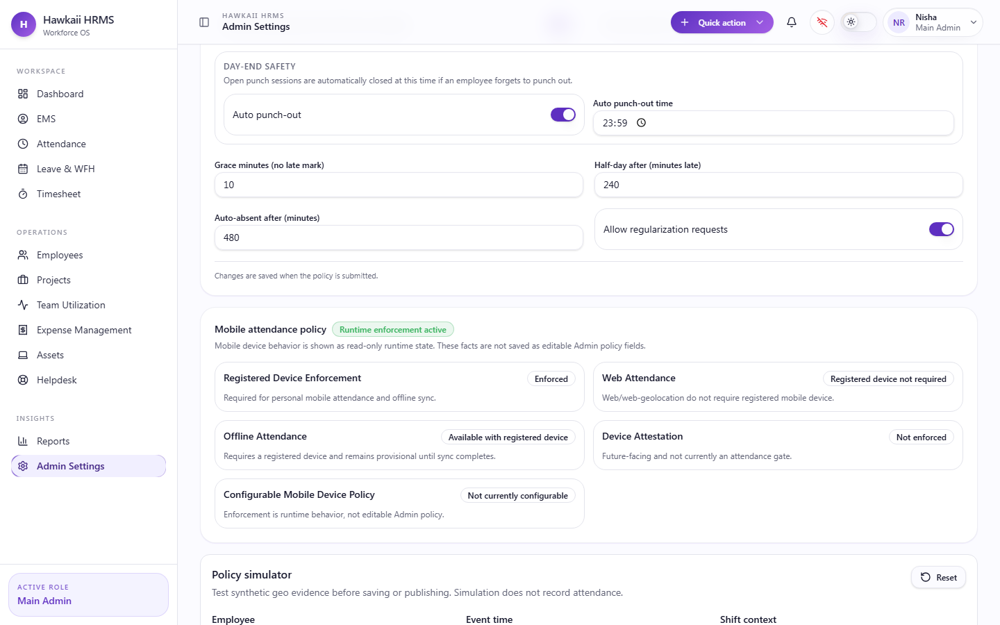

# GEO-S14-017 Documentation Screenshots & UI Acceptance Pack

## Scope

This pack documents the current manual attendance, geo attendance, Admin geofence/policy, regularization, and device management/device policy UI.

GEO-S14-017 is documentation/test-only. It does not change production frontend behavior, production backend behavior, API contracts, OpenAPI, or database schema.

All screenshots use synthetic fixtures and mocked API/geolocation responses. No production employee data, real exact attendance coordinates, installation hashes, raw device identifiers, client event IDs, or internal evidence IDs are included.

## Capture Method

| Item | Value |
|---|---|
| Capture spec | `hrms-client/e2e/docs/geo-s14-017-screenshots.spec.ts` |
| Capture date | 2026-10-07 |
| Backend dependency | None; frontend API requests are mocked |
| Geolocation | Synthetic Playwright browser geolocation mock |
| Employee/mobile viewport | `390 x 844` |
| Admin/desktop viewport | `1440 x 900` |
| Image format | PNG |

## Screenshot Inventory

| ID | Screen | Route | Viewport | File |
|---|---|---|---|---|
| 01 | Manual attendance ready | `/attendance` | `390 x 844` | `./screenshots/01-manual-attendance-ready-mobile.png` |
| 02 | Geo attendance accepted | `/attendance` | `390 x 844` | `./screenshots/02-geo-attendance-accepted-mobile.png` |
| 03 | Geo fallback/review | `/attendance` | `390 x 844` | `./screenshots/03-geo-manual-fallback-mobile.png` |
| 04 | Regularization entry | `/attendance?regularizeDate=2026-01-14` | `390 x 844` | `./screenshots/04-regularization-entry-mobile.png` |
| 05 | Admin geo/geofence policy | `/admin-settings/geo` | `1440 x 900` | `./screenshots/05-admin-geo-geofence-desktop.png` |
| 06 | Employee registered devices | `/ems/profile` | `390 x 844` | `./screenshots/06-employee-devices-mobile.png` |
| 07 | Admin device management | `/admin-settings/devices` | `1440 x 900` | `./screenshots/07-admin-device-management-desktop.png` |
| 08 | Admin device policy facts | `/admin-settings/policies` | `1440 x 900` | `./screenshots/08-admin-device-policy-desktop.png` |

## 1. Manual Attendance

Route: `/attendance`  
Viewport: `390 x 844`  
State: Employee ready-to-punch state under `manual_only` attendance policy.



### Acceptance Notes

- The employee can see the current attendance state, server time, work/break/target counters, work mode, and primary `Clock in` action.
- The manual-only fixture renders without a browser location request or permission prompt.
- The mobile layout fits the `390 x 844` viewport without document-level horizontal overflow.
- The normal employee UI does not expose raw geo evidence, coordinates, client event IDs, or internal IDs.

### QA Reference

- `hrms-client/e2e/attendance-browser-geo.spec.ts`
- `hrms-client/e2e/attendance-mobile-responsive.spec.ts`

## 2. Geo Attendance - Accepted

Route: `/attendance`  
Viewport: `390 x 844`  
State: Employee performs an explicit attendance action under a geo-enabled policy; mocked location evidence receives an accepted decision.



### Acceptance Notes

- Location capture occurs only after the explicit attendance action.
- The employee sees a safe accepted geo outcome and reason text.
- Successful location evidence is represented without raw latitude/longitude in the employee UI.
- The UI does not imply continuous or background tracking.
- The result remains readable on the mobile viewport.

### QA Reference

- `hrms-client/e2e/attendance-browser-geo.spec.ts`
- `hrms-client/e2e/attendance-mobile-responsive.spec.ts`

## 3. Geo Attendance - Manual Fallback / Review

Route: `/attendance`  
Viewport: `390 x 844`  
State: Permission-denied synthetic geolocation produces the current manual fallback/review UX.



### Acceptance Notes

- The fallback state is explicit and review-oriented.
- Location failure reason text is safe and employee-facing.
- The fallback action is distinct from a normal approved punch.
- No raw coordinates or internal fallback/evidence identifiers are displayed.

### Manual Fallback vs Regularization

Manual fallback is an attendance-time path when geo evidence cannot satisfy policy. Regularization is a later correction workflow for historical attendance changes.

### QA Reference

- `hrms-client/e2e/attendance-browser-geo.spec.ts`
- `hrms-client/e2e/attendance-mobile-responsive.spec.ts`

## 4. Regularization

Route: `/attendance?regularizeDate=2026-01-14`  
Viewport: `390 x 844`  
State: Employee prepares a historical correction request using synthetic date, reason, punch type, and requested time.



### Acceptance Notes

- The employee can identify the work date being corrected.
- Correction type, requested punch, requested time, and reason are visible.
- The form communicates that the request is submitted as pending and requires manager approval.
- The form remains usable on mobile without horizontal overflow.
- The screenshot uses synthetic free text and does not expose workflow/internal IDs.

### QA Reference

- `hrms-client/e2e/attendance-regression.spec.ts`
- `hrms-client/e2e/attendance-mobile-responsive.spec.ts`

## 5. Admin Geo / Geofence Policy

Route: `/admin-settings/geo`  
Viewport: `1440 x 900`  
State: Main Admin views synthetic work site, geofence, draft version, and policy simulator context.



### Acceptance Notes

- Admin can see the site/geofence relationship for the synthetic `Bengaluru Office`.
- Version/publish context is visible, including the draft circle shape.
- The policy simulator area uses synthetic scenario data and states that it does not fetch employee location history.
- Coordinate fields shown in this Admin configuration screenshot are synthetic geofence editor values, not employee exact attendance evidence.
- No production customer site coordinates or internal IDs are included.

### QA Reference

- `hrms-client/e2e/admin-geo.spec.ts`
- `hrms-client/e2e/admin-geo-model.spec.ts`

## 6. Employee Registered Devices

Route: `/ems/profile`  
Viewport: `390 x 844`  
State: Employee profile shows one synthetic registered Android device.



### Acceptance Notes

- The employee can review their own registered device status.
- Platform, masked device label, registered timestamp, status-changed timestamp, and revoke affordance are visible.
- The raw registered device UUID and installation hash are not displayed.
- The mobile device card remains readable on the phone viewport.

### QA Reference

- `hrms-client/e2e/device-management.spec.ts`

## 7. Admin Device Management

Route: `/admin-settings/devices`  
Viewport: `1440 x 900`  
State: Main Admin views synthetic registered and suspended device rows.



### Acceptance Notes

- Admin can inspect owner, employee code, platform, lifecycle status, registration/status timestamps, masked device label, and revoke affordance.
- Lifecycle status differences are visible through registered and suspended synthetic devices.
- Raw registered device UUIDs and installation hashes are not displayed.
- This screenshot does not imply access for non-main-admin roles.

### QA Reference

- `hrms-client/e2e/device-management.spec.ts`

## 8. Admin Device Policy

Route: `/admin-settings/policies`  
Viewport: `1440 x 900`  
State: Main Admin views the current read-only mobile attendance policy facts.



### Acceptance Notes

- The policy panel visibly labels mobile attendance behavior as read-only runtime state.
- Registered device enforcement, web attendance, offline attendance, device attestation, and configurability facts are readable.
- Device attestation is shown as not enforced.
- Configurable mobile device policy is shown as not currently configurable.
- The screenshot does not represent read-only/future-facing items as active persisted Admin controls.

### QA Reference

- `hrms-client/e2e/admin-device-policy-placeholders.spec.ts`
- `hrms-client/e2e/device-management.spec.ts`

## Functional vs Placeholder Device Policy

### Functional Today

- Employee device list.
- Employee revoke affordance for active own devices.
- Admin device inventory.
- Admin lifecycle action affordances.
- Registered-device runtime enforcement for relevant mobile/offline behavior.

### Read-Only / Future-Facing Today

- Configurable mobile device policy controls are not currently configurable.
- Device attestation is not enforced.
- Web/web-geolocation attendance does not require a registered mobile device.

## Privacy & Demo Safety

All screenshots in this pack were generated from synthetic test fixtures and mocked API/geolocation state. No production employee data, real exact attendance coordinates, installation hashes, raw device identifiers, client event IDs, request IDs, audit IDs, or internal evidence IDs are included.

The pack intentionally excludes exact-location reveal screenshots. Any exact-location reveal control must remain inactive for committed documentation evidence unless a future task explicitly asks to document it.

## Automated Coverage References

- `hrms-client/e2e/attendance-browser-geo.spec.ts`
- `hrms-client/e2e/attendance-mobile-responsive.spec.ts`
- `hrms-client/e2e/attendance-regression.spec.ts`
- `hrms-client/e2e/attendance-manager-review-model.spec.ts`
- `hrms-client/e2e/attendance-manager-exact-location.spec.ts`
- `hrms-client/e2e/admin-geo.spec.ts`
- `hrms-client/e2e/admin-device-policy-placeholders.spec.ts`
- `hrms-client/e2e/device-management.spec.ts`

## Validation

| Check | Command / Method | Result |
|---|---|---|
| Screenshot capture | `E2E_SKIP_WEB_SERVER=1 E2E_BASE_URL=http://localhost:5173 playwright test geo-s14-017-screenshots.spec.ts --workers=1` | PASS - 8/8 screenshots generated |
| Focused referenced E2E coverage | `playwright test attendance-browser-geo.spec.ts attendance-mobile-responsive.spec.ts attendance-regression.spec.ts admin-geo.spec.ts device-management.spec.ts admin-device-policy-placeholders.spec.ts --workers=1` | PASS - 39/39 tests |
| Screenshot dimensions | PowerShell `System.Drawing.Image` dimension check | PASS - mobile images are `390 x 844`, Admin images are `1440 x 900` |
| Visual inspection | Manual review of all eight PNGs | PASS - no loading skeletons, broken fonts, raw device IDs, real coordinates, or internal error UI observed |
| Markdown links | Relative paths reviewed against generated files | PASS |
| Repository whitespace | `git diff --check` | PASS |

## Known Limitations

- The Admin geo screenshot includes synthetic longitude/latitude fields because they are part of the Admin geofence editor. These are not employee exact-location evidence.
- The Admin geo simulator is visible as page context, but the screenshot prioritizes the work-site/geofence/version relationship rather than a separate simulator result state.
- The device revoke confirmation dialog is not separately captured; existing automated device-management coverage verifies the confirmation workflow.

## Production Impact

```text
Production frontend changes: None
Production backend changes: None
API/OpenAPI changes: None
Database migration: None
Product behavior changes: None
```
